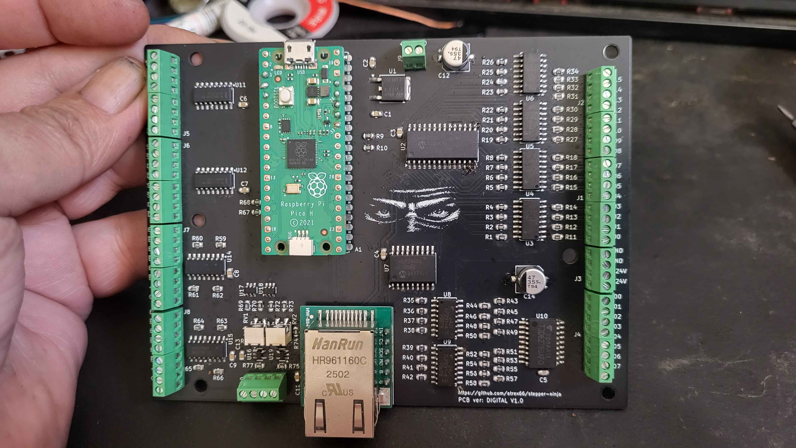

# stepper-ninja

Nyílt forráskódú, ingyenes, nagy teljesítményű step-generátor, digitális I/O és PWM interfész LinuxCNC-hez és Mach3-hoz.

**ÚJ — a 3 tengelyes Mach3 driver első verziója (USB):**
[StepperNinja Mach3 USB csomag](configurations/StepperNinja-Mach3-USB).
Pico/Pico 2 firmware, Windows plugin, gépprofilok és
[telepítési útmutató](configurations/StepperNinja-Mach3-USB/README.hu.md).

Külön **prototípus Mach3 driver** is elérhető, fix háromtengelyes USB/UDP
firmware-profillal. A LinuxCNC marad az alapértelmezett, rugalmas profil.

A stepper-ninja használatához nincs szükség a hivatalos breakout boardra. Egy olcsó printer-port breakout board is elég lehet, és más konfigurációk is használhatók.



## Dokumentáció

- [Telepítési útmutató](docs/INSTALL.hu.md)
- [Konfigurációs útmutató](docs/CONFIG.hu.md)
- [IP konfiguráció](docs/IPCONFIG.hu.md)
- [Saját breakout board készítése](docs/MAKE-YOUR-OWN-BREAKOUTBOARD.hu.md)
- [Mach3 prototípus áttekintés](docs/MACH3.hu.md) ([English](docs/MACH3.en.md))
- [Mach3 fordítási útmutató](docs/MACH3-BUILD.hu.md) ([English](docs/MACH3-BUILD.en.md))
- [Mach3 protokoll és végrehajtási reportok](docs/MACH3-PROTOCOL.hu.md)
- [Mach3 Feed Hold és G31](docs/MACH3-FEEDHOLD-G31.hu.md)

## Nyelvek

- [English](README.md)
- [Deutsch](README.de.md)
- [हिन्दी](README.hi.md)
- [Magyar](README.hu.md)
- [Português (Brasil)](README.pt-BR.md)

## LinuxCNC jellemzők

A LinuxCNC profil támogatja a kvadratúrás enkódereket és a főorsó-szinkron mozgásokat, például a menetvágást. A Mach3 driverben az enkódertámogatás még nincs megvalósítva.

- **Támogatott konfigurációk**:

  - W5100S-evb-pico UDP Ethernet
  - W5500-evb-pico
  - W5100S-evb-pico2
  - W5500-evb-pico2
  - pico + W5500 modul
  - pico2 + W5500 modul
  - pico + Raspberry Pi4 SPI kapcsolaton
  - pico2 + Raspberry Pi4 SPI kapcsolaton
  - pico + PI ZERO2W SPI kapcsolaton
  - pico2 + PI ZERO2W SPI kapcsolaton
  - hivatalos Stepper-Ninja breakout board

- **Breakout-board v1.0 - digitális verzió**: 16 optocsatolt bemenet, 8 optocsatolt kimenet, 4 step-generátor, 2 nagysebességű enkóderbemenet, 2 unipoláris 12 bites DAC kimenet.

- **step-generator**: maximum 8 Pico 1 esetén, maximum 12 Pico2 esetén. Csatornánként akár 1 MHz. Az impulzusszélesség HAL pinről állítható.

- **quadrature-encoder**: maximum 8 Pico1 esetén, maximum 12 Pico2 esetén. Nagy sebesség, indexkezelés, sebességbecslés és főorsó-szinkron mozgások támogatása.

- **digitális I/O**: a Pico szabad lábai bemenetként és kimenetként konfigurálhatók.

- **PWM**: legfeljebb 16 GPIO használható PWM kimenetként.

- **Szoftver**: LinuxCNC HAL driver több példánnyal és biztonsági funkciókkal.

- **Open source**: a kód és a dokumentáció MIT licenc alatt érhető el.

- **minta KiCad breakout board**: egy egyszerű, filléres DIY breakout board KiCad projekt érhető el a `configurations/RaspberryPi` könyvtárban. Egy Pico/Pico2-t köt össze a Raspberry Pi-vel SPI-on keresztül, és csupán egy Pico vagy Pico2, egy szabványos 40 pólusú GPIO csatlakozó és 2,54 mm-es nyákos sorkapcsok szükségesek hozzá.

## Mach3 prototípus driver

A `mach3-driver/` Mach3 SDK adaptert és hordozható vezérlő/kliens magot tartalmaz.
A hozzá tartozó firmware fordításakor `STEPPER_NINJA_PROFILE=mach3-3axis` kell.
A profil kiosztása fix: három STEP/DIR tengely, hét digitális bemenet,
hat digitális kimenet és egy főorsó PWM kimenet.

A prototípusban megvalósított funkciók:

- Pufferelt, 1 ms-os XYZ mozgás, fizikai STEP számlálás szerinti reportokkal.
- Helyi gyorsuláskorlátozott jog, homing és dwell.
- Digitális I/O, főorsó RUN/DIR/PWM és hűtéskimenetek.
- Session, ACK, ismételt kérés kiszűrése, watchdog, E-stop és limitkezelés.
- Mach3 konfigurációs ablak IP/port, időzítés, polaritás és homing beállításokkal.
- Natív Mach3 Feed Hold: a fékezési pálya továbbítása; Cycle Startkor a Mach3
  új indulópályájának továbbítása.
- Koordinált G31 külön érintési és megállási pozícióval, sikertelen keresés
  felismerésével és kontrollált megszakítással.

**Prototípus státusz:** a Linux tesztek mozgást, reportokat és UDP működést
ellenőriznek, helyettesített Mach3 pályatervezővel. Windows alatt igazoltam,
hogy az előre fordított driverrel és firmware-rel a Mach3 USB STEP-jelkimenetei
és bemenetei is működnek.
A teljes Mach3 Feed Hold/G31 integráció és a hardveridőzítés még ellenőrizendő.
USB CDC mozgástranszport automatikus konzolátadással megvalósított;
a teljes Windows- és fizikai gépteszt még hátravan. A Mach3 profilnak nincs encodere;
a LinuxCNC fent felsorolt teljesítmény- és konfigurációs lehetőségei nem ennek
a profilnak a korlátait írják le. A 3-as mozgásprotokoll-verzióhoz egyező Mach3
driver és firmware build szükséges.
A Pico firmware natívan Windows alatt is fordítható; a firmware és a Mach3 DLL
elkészítéséhez nem szükséges Linux gép. Amikor a valódi Mach3- és hardvertesztek
igazolták a megbízható működést, tervezett release készül előre fordított
firmware-rel és driverrel. Ez az igazolt release még nem érhető el.

[Mach3 USB konfigurációs könyvtár — előre fordított driver, firmware és gépprofilok](configurations/StepperNinja-Mach3-USB).

Lásd a [magyar fordítási útmutatót](docs/MACH3-BUILD.hu.md) vagy az
[angol változatot](docs/MACH3-BUILD.en.md). A külön Mach3 profil megőrzi
az alapértelmezett LinuxCNC konfigurálhatóságát és protokollját.

## PIO-konfiguráció és erőforrás-korlátok

A Raspberry Pi Pico és Pico2 **PIO-blokkokat (Programmable I/O)** használ a step-generátorok és encoder-számlálók hardveres megvalósításához. Mivel a PIO-utasításmemória rendkívül korlátozott, **a step-generátorok és az encoderek nem használhatók egyszerre** — az egyik engedélyezése letiltja a másikat.

### RP2040 (Pico)

- 2 PIO-blokk (PIO0 és PIO1), mindkettőben **4 állapotgép** és **32 utasításhely**
- Step-generátor PIO-program: ~20 utasítás állapotgépenként
- Encoder PIO-program: ~15–18 utasítás állapotgépenként
- **4 step-generátor** teljesen kitölt egy PIO-blokkot — nem marad hely encoder számára ugyanabban a blokkban
- **4 encoder** teljesen kitölt egy PIO-blokkot — nem marad hely step-generátor számára
- Maximum: **8 step-generátor** VAGY **8 encoder** (mindkét PIO-blokk felhasználásával), soha nem vegyítve

### RP2350 (Pico2)

- 2 PIO-blokk, mindkettőben **4 állapotgép** és **32 utasításhely** (azonos struktúra, mint az RP2040)
- Az RP2350 rendelkezik egy további **PIO2** blokkal, amely 4 további állapotgépet tartalmaz
- Maximum: **12 step-generátor** VAGY **12 encoder** (mindhárom PIO-blokk felhasználásával)
- A step-generátorok és encoderek keveredése továbbra sem lehetséges — minden funkció PIO-programja teljesen kitölti a blokkot

### Módok közötti váltás

Szerkeszd a `firmware/inc/config.h` fájlt a kívánt mód beállításához:

```c
#define stepgens 4   // step-generátorok száma (0 = csak encoder mód)
#define encoders 0   // encoderek száma (0 = csak step-generátor mód)
```

A beállítás módosítása után build-eld újra a firmware-t, és flasheld a Picóra.

### Encoder PIO-változatok

Két encoder-implementáció áll rendelkezésre:

- **`ENCODER_PIO_SUBSTEP`** (alapértelmezett): sub-step interpoláció a sima sebességbecsléshez (~18 utasítás)
- **`ENCODER_PIO_LEGACY`**: egyszerű kvadratúra-számlálás, kissé kisebb (~15 utasítás)

Legacy encoderrel való build:
```bash
CFLAGS='-Dencoder_pio_version=ENCODER_PIO_LEGACY' cmake ..
```

---

## Licenc

- A kvadratúrás encoder PIO program a Raspberry Pi (Trading) Ltd. BSD-3 licencét használja.
- Az `ioLibrary_Driver` a Wiznet MIT licencével érhető el.

A LinuxCNC 2.9/2.10 HAL API kompatibilitási patch [Frederic Müller (FredericM88)](https://github.com/FredericM88) [linuxcnc-sim](https://github.com/FredericM88/linuxcnc-sim/tree/42ef3723da83b8ed88c123138c60437093255a22/compat/stepper-ninja) projektben közzétett kódján alapul, amelyet MIT-licenc alatt igazítottunk ehhez a driverhez. Lásd a [kompatibilitási leírást](hal-driver/hal-api-compatibility.md) és az [eredeti licencet](hal-driver/LICENSE.hal-compat.txt).
